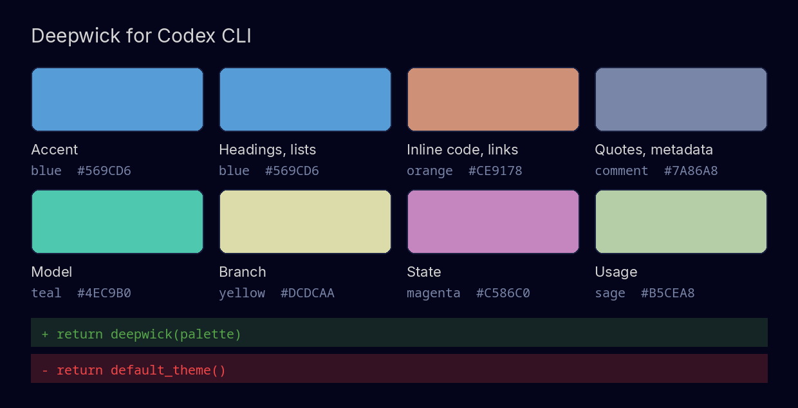

# Deepwick for Codex CLI

Deepwick colors for [Codex CLI](https://github.com/openai/codex), OpenAI's
terminal coding agent.

> Deepwick is an unofficial theme derived from
> [Polywick Blue](https://vscode.polywickstudio.net) by Polywick Studio (MIT).
> Not affiliated with Polywick Studio.

**Not yet checked in Codex.** The theme was written from the Codex 0.170.0
source. It loads in syntect 5, the library Codex uses, and every scope Codex
reads resolves to the colors below, but nobody has run it in Codex yet. The
preview is a swatch of the colors, not a screenshot of Codex. Screenshots and reports are welcome.



## Install

```sh
mkdir -p "${CODEX_HOME:-$HOME/.codex}/themes"
cp deepwick.tmTheme "${CODEX_HOME:-$HOME/.codex}/themes/deepwick.tmTheme"
```

Then pick **deepwick** with `/theme` in Codex, or set it in
`~/.codex/config.toml`:

```toml
[tui]
theme = "deepwick"
```

Codex uses the terminal's own background. Pair this with a Deepwick terminal
theme ([Ptyxis](https://github.com/deepwick/ptyxis),
[Konsole](https://github.com/deepwick/konsole),
[Ghostty](https://github.com/deepwick/ghostty), …).

## What it colors

Codex reads a TextMate theme for more than code blocks:

| Codex element                       | Scope                         | Deepwick role         |
| ----------------------------------- | ----------------------------- | --------------------- |
| Selection and accent                | `codex.accent`                | Blue                  |
| Diff added / removed lines          | `markup.inserted` / `deleted` | Green / Red on diff backgrounds |
| Markdown headings, lists            | `markup.heading`, `markup.list` | Blue                |
| Markdown inline code, links         | `markup.raw`, `markup.underline.link` | Orange        |
| Markdown quotes                     | `markup.quote`                | Comment               |
| Status line: model                  | `entity.name.type`            | Teal                  |
| Status line: path                   | `string`                      | Orange                |
| Status line: branch                 | `entity.name.function`        | Yellow                |
| Status line: state                  | `keyword.control`             | Magenta               |
| Status line: usage                  | `constant.numeric`            | Sage                  |
| Status line: metadata               | `comment`                     | Comment               |

Code syntax colors match [Deepwick for bat](https://github.com/deepwick/bat).
The theme is generated by `generate.py` from the Deepwick palette.

## Notes

- Codex draws bold but no italics, so comments are not italic.
- Codex ignores theme backgrounds except on diff lines.
- The accent comes from the theme only in 256-color and truecolor terminals.

Tested with Codex CLI 0.170.0 source only (not run).

## License

MIT. See [LICENSE](LICENSE).
